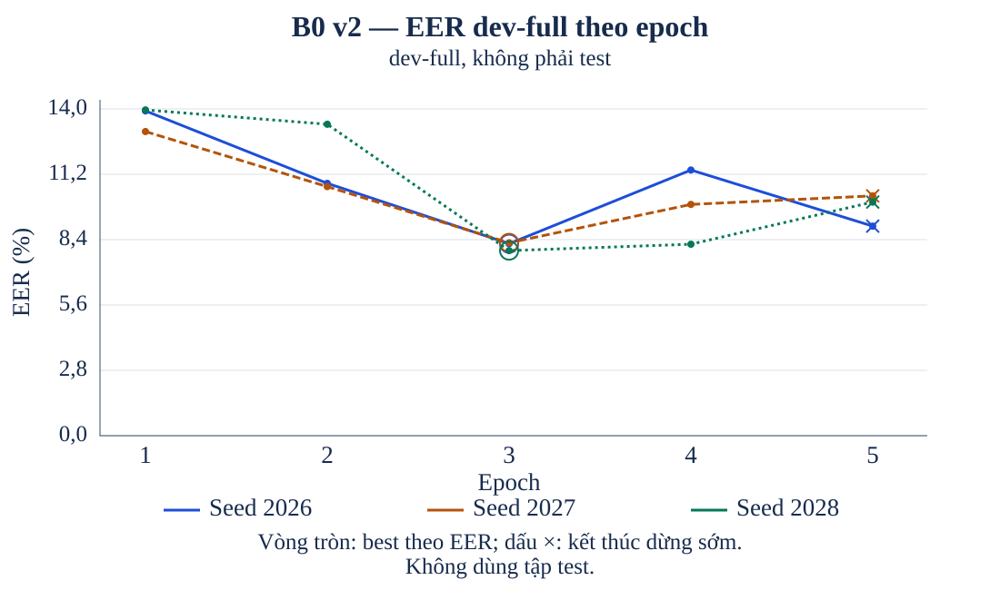
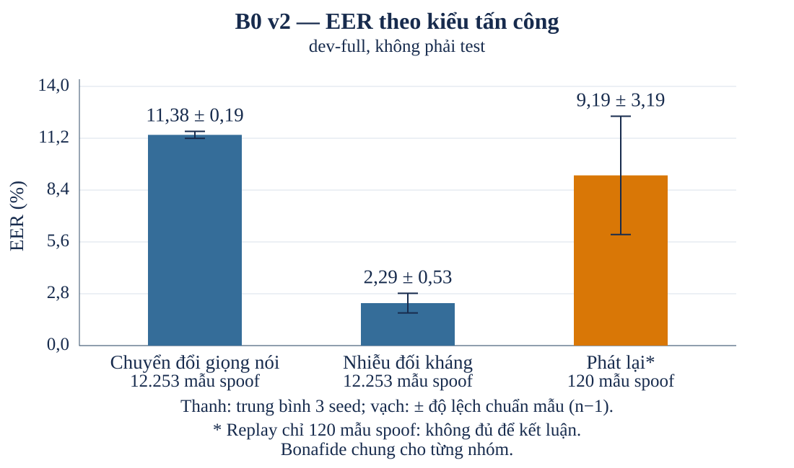
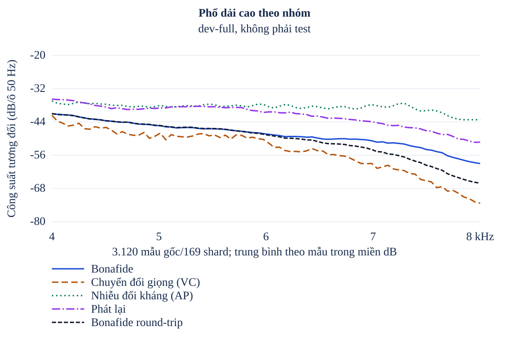
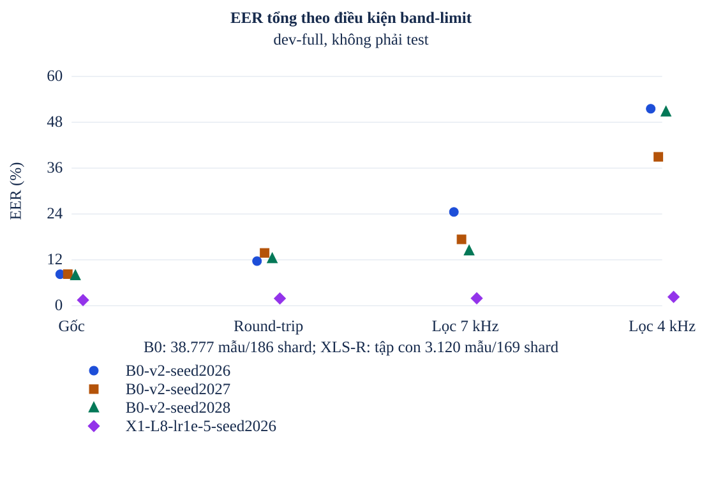

# Phương pháp, dữ liệu và kết quả B0 v2 (LFCC–LCNN)

> Cập nhật ngày 09/11/2026; bổ sung band-limit ablation theo D031. Phương pháp lấy từ mã nguồn, cấu hình và D015–D017, D022, D025–D028; kết quả chính thức lấy từ `reports/b0_v2_summary.json` và phân tích mới tại `reports/b0_v2_dev_analysis.json`. Toàn bộ kết quả là **dev-full, không phải test**. Tập test chưa được dùng trong chương này. Đây là bản nguồn để ghép vào các chương dữ liệu, phương pháp và kết quả; giữ các mục 1–7 của bản nháp. Caption dữ liệu dùng Bảng 2.x, phương pháp dùng Bảng 3.x; phần kết quả dùng Bảng/Hình 4.x theo hướng dẫn trình bày của trường.

## 1. Dữ liệu và bài toán

- **Dữ liệu:** VSASV, bản snapshot công khai trên Hugging Face (`VSASV-HF-public-snapshot-v1`), lưu dưới dạng Parquet theo 432 shard.
- **Bài toán:** phân loại nhị phân, `0 = bonafide` (giọng thật), `1 = spoof` (giọng giả).
- **Gộp nhãn:** voice conversion, adversarial attack và replay đều thành `spoof`. Trường `utt_type` chỉ dùng để thống kê và phân tích lỗi theo kiểu tấn công, không dùng làm nhãn huấn luyện.
- **Giao thức chính:** `closed_train`, `closed_dev`, `closed_test`, chia theo người nói (speaker-disjoint), seed `2026`.

**Quy mô dữ liệu thực dùng:**

Bảng 2.1. Quy mô và vai trò của các tập dữ liệu (nguồn: `reports/b0_v2_summary.json`; quy mô test là thông tin lịch sử D025, không đọc test trong R1).

| Tập | Số mẫu | Vai trò |
|---|---:|---|
| Train (`development-20k-v2`) | 15.885 | huấn luyện mọi mô hình |
| Dev-full | 38.777 | chọn checkpoint, early stopping, threshold, so sánh cấu hình |
| Test-full | 30.698 | đánh giá cuối, mỗi mô hình một lần; chưa đọc |

Train chỉ là khoảng 10,5% `closed_train` do giới hạn đĩa, thời gian và quota GPU (D025). Dev-full và test-full giữ gần như toàn bộ `closed_dev` và `closed_test` sau khử trùng, để phép đánh giá đủ độ phủ người nói.

## 2. Chia tập theo người nói và kiểm tra rò rỉ

### 2.1. Vì sao chia theo người nói

Nếu cùng một người xuất hiện ở cả train và test, mô hình có thể nhận ra giọng người đó thay vì học cách phân biệt thật/giả, làm kết quả lạc quan giả tạo. Vì vậy một người nói chỉ thuộc đúng một tập.

### 2.2. Bộ kiểm tra rò rỉ (`scripts/check_leakage.py`)

Đây là cổng kiểm tra **cấu trúc chia tập**, chạy trên metadata và các file split. Trong metadata, cột `label` là mã người nói, và đường dẫn file bắt đầu bằng mã đó.

**Kiểm tra trong từng tập:**
- không có đường dẫn file lặp hoặc dòng lặp;
- `utt_type` chỉ thuộc bốn giá trị hợp lệ (bonafide, voice_conversion, adversarial_attack, replay);
- mọi dòng phải khớp metadata nguồn;
- phần đầu đường dẫn file phải khớp mã người nói, để phát hiện dòng bị gán nhầm người;
- đủ cột, không thiếu giá trị.

**Kiểm tra giữa các tập:**
- với mọi cặp trong `closed_train/dev/test`: giao của tập người nói phải rỗng, giao của tập file phải rỗng;
- hợp của ba tập phải đúng bằng metadata, không thừa không thiếu;
- với giao thức open: các ràng buộc về loại tấn công được phép trong từng tập, cùng nhóm người nói và cùng bonafide pool giữa seen-VC test và unseen-adversarial test.

**Tùy chọn:** khi cung cấp thư mục audio, kiểm tra file tồn tại và băm SHA-256 nội dung tệp.

**Kết quả:** ghi `reports/leakage_check.json` và `.md`, gồm trường `passed` và danh sách `issues`.

## 3. Khử trùng nội dung bằng hàm băm

### 3.1. Vấn đề

Hai file khác tên, thậm chí gán cho khác người nói, vẫn có thể chứa cùng một đoạn âm thanh. Kiểm tra theo tên file hay người nói không phát hiện được trường hợp này. Kiểm tra ngày 08/10/2026 trên 34.782 waveform cục bộ tìm ra 91 nhóm (182 file) bonafide trùng nội dung, trong đó 17 nhóm đi qua cả train và development (D017).

### 3.2. Cách băm (`waveform_sha256`)

Băm được tính trên **mảng mẫu gốc** đọc từ Parquet, trước mọi biến đổi:

1. Lấy các giá trị mẫu gốc ở dạng `float64` (giá trị số thực mà bộ đọc Parquet trả về).
2. Khởi tạo SHA-256.
3. Đưa vào **sample rate gốc**, mã hóa thành số nguyên có dấu 8 byte, little-endian.
4. Đưa tiếp **toàn bộ mẫu `float64`** dưới dạng byte little-endian.
5. Chuỗi hex 64 ký tự là `content_sha256` của file.

**Lý do thiết kế:**
- `float64` và thứ tự byte cố định cho kết quả giống nhau trên mọi máy.
- Đưa sample rate vào hash để cùng dãy số ở hai tốc độ lấy mẫu (thực chất là hai âm thanh khác nhau) không bị coi là trùng.
- Băm trên dữ liệu gốc, trước resample và ép kiểu, nên "trùng" nghĩa là trùng từng bit với bản gốc và không phụ thuộc vào các bước xử lý phía sau.

### 3.3. Quy tắc giữ và loại (D017, D025)

- Các file cùng hash tạo thành một nhóm.
- **Trong cùng một tập:** chỉ giữ một đại diện, là file có khóa `SHA256("2026|<tên file>")` nhỏ nhất. Khóa phụ thuộc seed và tên file nên kết quả xác định, không chọn thủ công.
- **Giữa các tập, theo thứ tự ưu tiên:** train luôn được giữ; dev-full loại mọi mẫu trùng train; test-full loại mọi mẫu trùng train hoặc dev-full. Không bù mẫu.
- **Điều kiện dừng khai báo trước:** nếu một cặp (tập, kiểu tấn công) mất hơn 5% số dòng gốc, hoặc một nhóm hash trộn hai nhãn nhị phân, thì dừng và báo cáo.
- **Kiểm chứng:** sau khi tạo manifest, đọc và băm lại độc lập toàn bộ waveform, lưu hash từng dòng, và xác nhận số nhóm hash lặp bằng 0.

### 3.4. Hai loại mã băm trong dữ liệu đóng gói

Bảng 2.2. Hai loại mã băm phục vụ khử trùng và kiểm toàn vẹn.

| Mã băm | Tính trên | Mục đích |
|---|---|---|
| `content_sha256` | mẫu `float64` gốc + sample rate, trước resample | nhận diện nội dung, phục vụ khử trùng |
| `waveform_sha256` | đúng các byte `float32` đã lưu | kiểm tính toàn vẹn của dữ liệu đóng gói |

Ngoài ra, mã băm toàn tệp waveform của từng artifact được khóa trong cấu hình huấn luyện, để mỗi run đọc đúng phiên bản dữ liệu.

## 4. Chuẩn hóa âm thanh

Mục tiêu là thống nhất tần số lấy mẫu, chính sách biên độ và độ dài đầu vào, nhằm giảm nguy cơ mô hình khai thác các yếu tố kỹ thuật này như đường tắt (shortcut). Các bước này không chứng minh đã loại bỏ hoàn toàn shortcut; phép thử band-limit ablation phiên bản đầu được trình bày tại mục 9.6.

Thứ tự xử lý:

```
Mảng gốc từ Parquet (float64, sample rate gốc)
  ├─► băm content_sha256 (mục 3)
  └─► kiểm tra → ép float32 → resample 16 kHz → [lưu packed]
                 → chuẩn hóa biên độ peak trên toàn file → cắt 4 giây
```

### 4.1. Giải mã và kiểm tra

- Waveform được đưa về `float32` trong khoảng [-1, 1].
- Loader yêu cầu waveform **một chiều (mono)** và không rỗng; file không thỏa bị từ chối.
- File có sample rate không hợp lệ hoặc chứa NaN/vô cực bị từ chối.
- Metadata (người nói, `utt_type`, sample rate gốc) phải khớp với Parquet.

### 4.2. Resample về 16 kHz

**Vấn đề:** dữ liệu gốc không đồng nhất về sample rate. Trong mẫu kiểm tra cục bộ, bonafide, adversarial attack và replay ở 16 kHz, còn voice conversion ở 40 kHz (`docs/audio_protocol.md`). File 40 kHz chứa tần số tới 20 kHz, file 16 kHz chỉ tới 8 kHz. Nếu giữ nguyên, mô hình có thể phân biệt nhãn chỉ nhờ băng thông.

**Cách làm:** mọi waveform được ép sang `float32` rồi resample về 16 kHz bằng `torchaudio.functional.resample`, dùng nội suy sinc giới hạn băng tần. Bộ lọc loại bỏ phần tần số trên 8 kHz trước khi tính lại mẫu ở các thời điểm mới, tránh méo tín hiệu (aliasing). File đã ở 16 kHz không cần resample. Sau bước này, mọi file có cùng tần số lấy mẫu và giới hạn Nyquist 8 kHz. Điều đó không bảo đảm phổ hoặc dấu vết của sample rate gốc đã giống nhau. Mục 9.6 đo phổ dải cao và kiểm tra độ nhạy của mô hình bằng band-limit ablation theo D007/D031.

### 4.3. Chuẩn hóa biên độ theo `peak`

**Vì sao cần.** Độ to của file phụ thuộc cách thu âm, không phụ thuộc thật hay giả. Nhưng trong dữ liệu, độ to khác nhau rõ theo loại (`reports/amplitude_audit.md`, audit 30/09/2026 trên 2.558 waveform từ 5/432 shard, không đại diện ngẫu nhiên cho toàn bộ dữ liệu):

Bảng 2.3. RMS cục bộ theo loại phát ngôn (nguồn: `reports/amplitude_audit.md`).

| Loại | RMS trung vị (dBFS) |
|---|---:|
| Replay | -16,47 |
| Bonafide | -21,29 |
| Adversarial attack | -23,36 |
| Voice conversion | -23,91 |

Nếu không chuẩn hóa, mô hình có thể học "file to là replay".

**Các đại lượng đo:**
- **Đỉnh (peak):** `peak = max |x|`, giá trị tuyệt đối lớn nhất của waveform.
- **RMS:** `RMS = sqrt(mean(x²))`, độ to trung bình.
- **dBFS:** `RMS_dBFS = 20 · log10(max(RMS, 1e-8))`. 0 dBFS là mức lớn nhất có thể; -20 dBFS tương ứng RMS 0,1; -50 dBFS tương ứng RMS khoảng 0,0032 (gần im lặng). Hằng số `1e-8` tránh tính log của 0.

**Quy trình `apply_amplitude_policy` với `peak`:**
1. Đo peak và RMS trên **toàn bộ file đã resample**, tính bằng `float64` để tránh sai số làm tròn.
2. Nếu `RMS_dBFS < -50`, file được coi là **gần im lặng**: giữ nguyên (gain = 1) và đánh dấu `near_silence`. Lý do: khuếch đại file im lặng chỉ biến nhiễu nền thành tiếng ồn lớn.
3. Ngược lại, tính `gain = 0,95 / peak` và nhân **toàn bộ** waveform với hệ số này. Đỉnh đầu ra bằng 0,95.
4. Kiểm tra kết quả không chứa NaN/vô cực, đo lại peak và RMS đầu ra.
5. Ghi các trường audit: peak, RMS và RMS dBFS trước/sau, gain đã dùng, cờ `near_silence` và `peak_limited`.

**Ví dụ:** file có peak 0,40 thì gain = 0,95 / 0,40 = 2,375; mẫu 0,40 thành 0,95, mẫu -0,30 thành -0,7125.

**Tính chất:**
- Mọi mẫu nhân cùng một hệ số, giống vặn âm lượng, nên hình dạng sóng và nội dung phổ không đổi.
- Gain tính từ chính đỉnh, nên không mẫu nào vượt 0,95 và không cần cắt ngọn (hard-clip). Mức 0,95 chừa khoảng an toàn dưới mức tối đa 1.
- Cờ `peak_limited` luôn là false với `peak`; cờ này chỉ có ý nghĩa với `rms_dbfs`.

**So sánh ba chính sách ứng viên:**

Bảng 2.4. Ba chính sách biên độ đã khảo sát.

| Chính sách | Cách làm | Ưu điểm | Hạn chế |
|---|---|---|---|
| `none` | giữ nguyên | không can thiệp dữ liệu | còn shortcut độ to |
| `peak` | đưa đỉnh về 0,95 | đơn giản, không méo | hai file cùng đỉnh vẫn có thể khác độ to trung bình |
| `rms_dbfs` | đưa RMS về -25 dBFS, giới hạn gain để đỉnh không vượt 0,95 (khi đó bật `peak_limited`) | cân bằng độ to cảm nhận tốt hơn | phức tạp hơn, đôi khi không đạt đích |

Ba chính sách được so sánh bằng ba pilot B0 có cùng train, dev, seed và số bước. D022 chọn `peak` vì dev EER thấp nhất (9,1207%), không dùng test. Lựa chọn này hợp lý theo quy tắc khai báo trước nhưng chưa chứng minh `peak` tốt hơn hẳn, vì khoảng tin cậy bootstrap theo người nói của các hiệu EER chứa 0; ngoài ra ba pilot cùng mang lỗi LFCC phụ thuộc batch (mục 6).

**Vì sao đo trên toàn file rồi mới cắt.** Nếu đo trên đoạn đã cắt, gain sẽ phụ thuộc đoạn nào được chọn, nên cùng một file có mức to khác nhau ở mỗi epoch và mất tương quan độ to tự nhiên bên trong câu nói. Đo toàn file cho mỗi file một gain cố định.

### 4.4. Cắt về đúng 4 giây (`fixed_length_segment`)

Mô hình cần đầu vào cùng kích thước: 4 giây, tức 64.000 mẫu ở 16 kHz.

Bảng 2.5. Quy tắc chia đoạn theo độ dài và vai trò tập dữ liệu.

| Độ dài file | Cách xử lý |
|---|---|
| Dài hơn 4 giây, tập **train** | lấy đoạn 64.000 mẫu, điểm bắt đầu **ngẫu nhiên** trong `[0, độ dài − 64000]` |
| Dài hơn 4 giây, tập **dev/test** | điểm bắt đầu `(độ dài − 64000) // 2`, tức **cắt ở giữa** |
| Đúng 4 giây | giữ nguyên |
| Ngắn hơn 4 giây | **lặp** waveform đủ số lần rồi cắt đúng 64.000 mẫu |
| Rỗng | từ chối, không độn số 0 |

**Lý do:**
- **Cắt ngẫu nhiên khi train:** mỗi epoch mô hình thấy một phần khác của cùng file, tương tự tăng cường dữ liệu.
- **Cắt ở giữa khi đánh giá:** cùng một file luôn cho cùng đầu vào, kết quả lặp lại và so sánh được giữa các mô hình.
- **Lặp thay vì độn số 0:** độn số 0 tạo đoạn im lặng nhân tạo; nếu file ngắn tập trung ở một nhãn, mô hình có thể học "có đoạn im lặng là spoof".
- **Ngẫu nhiên nhưng tái lập được:** vị trí cắt sinh từ bộ số ngẫu nhiên có seed theo seed huấn luyện, chỉ số mẫu và epoch, nên chạy lại cùng cấu hình cắt đúng các vị trí cũ.

### 4.5. Đóng gói dữ liệu (packed artifact)

Đọc trực tiếp Parquet quá chậm cho huấn luyện. Dữ liệu được đóng gói một lần thành packed artifact:

- **Nội dung:** waveform `float32` little-endian **đã resample 16 kHz**, **chưa** chuẩn hóa biên độ và **chưa** cắt (giai đoạn `post_resample_pre_amplitude_pre_crop`). Chuẩn hóa và cắt vẫn thực hiện lúc đọc, đúng quy tắc mục 4.3–4.4.
- **Chỉ mục:** mỗi dòng gồm tên file, tập, người nói, `utt_type`, nhãn nhị phân, sample rate gốc, offset, số mẫu, `content_sha256`, `waveform_sha256`.
- **Toàn vẹn:** mỗi shard có một tệp đánh dấu hoàn tất ghi sau cùng, chứa hash của dữ liệu và chỉ mục; shard thiếu tệp này bị coi là chưa xong.
- **Vì sao `float32`:** mô hình tính bằng `float32`; dung lượng bằng một nửa `float64`; sai số làm tròn của `float32` nhỏ hơn nhiều so với sai số do resample.
- **Kiểm chứng parity:** đọc từ packed và đọc từ Parquet cho cùng kết quả, 0 mẫu lệch. Train phủ 100%; dev-full và test-full chỉ phủ phần có Parquet cục bộ (khoảng 18% và 16%).

## 5. Đặc trưng LFCC

### 5.1. LFCC là gì

LFCC (Linear Frequency Cepstral Coefficients) mô tả năng lượng âm thanh phân bố theo tần số và thay đổi theo thời gian, nén thành một số ít hệ số cho mỗi khung thời gian.

Waveform 64.000 mẫu dao động nhanh và nhạy với lệch pha, nên khó học trực tiếp. Biểu diễn tần số–thời gian ổn định hơn và làm lộ cấu trúc giọng nói cũng như dấu vết do hệ thống tạo giọng để lại.

**Khác MFCC:** MFCC chia dải tần theo thang mel (dày ở tần số thấp, thưa ở tần số cao, mô phỏng tai người). LFCC chia các dải **đều nhau**, giữ độ phân giải ở vùng tần số cao. Trong chống giả mạo giọng nói, dấu vết của hệ thống tổng hợp thường được cho là nằm ở vùng này, nên LFCC thường được dùng làm đặc trưng baseline.

### 5.2. Các bước tính (`torchaudio.transforms.LFCC`, tham số trong `configs/lfcc_lcnn.json`)

**Bước 1: chia khung và nhân cửa sổ.**

Bảng 3.1. Tham số tạo khung LFCC (nguồn: `configs/lfcc_lcnn.json`).

| Tham số | Giá trị | Ý nghĩa ở 16 kHz |
|---|---|---|
| `win_length` | 400 | khung dài 25 ms |
| `hop_length` | 160 | bước nhảy 10 ms (chồng 15 ms) |
| `window_fn` | Hann | giảm mép khung về 0 để phổ không bị nhòe |
| `center` | true, `pad_mode = reflect` | tâm khung tại 0, 160, 320…; hai đầu độn bằng phản chiếu |

Số khung = 64.000 / 160 + 1 = **401**.

**Bước 2: biến đổi Fourier.** `n_fft = 512` cho 257 điểm tần số cách nhau 31,25 Hz, từ 0 đến 8.000 Hz. `power = 2.0` lấy phổ năng lượng. Kết quả là spectrogram 257 × 401.

**Bước 3: bộ lọc tuyến tính.** 80 bộ lọc tam giác (`n_filter = 80`) chia đều 0–8.000 Hz, các tâm được phân bố đều và các bộ lọc chồng lên bộ lọc kề. Kết quả: 80 × 401. Đây là chỗ khác MFCC.

**Bước 4: đổi sang thang dB.** `dB = 10 · log10(năng lượng)`, nén khoảng giá trị rất rộng của năng lượng. Vì `log_lf = false`, torchaudio dùng `amplitude_to_DB` với ngưỡng sàn `top_db = 80`: mọi giá trị thấp hơn mức lớn nhất quá 80 dB được nâng lên bằng (lớn nhất − 80 dB).

**Bước 5: DCT.** `dct_type = 2`, `norm = "ortho"`, giữ 60 hệ số đầu (`n_lfcc = 60`). DCT giảm tương quan giữa các dải kề nhau. Hệ số bậc thấp mô tả hình dạng tổng thể của phổ, hệ số bậc cao mô tả chi tiết nhỏ.

**Kết quả:** ma trận 60 × 401 cho mỗi file, thêm chiều kênh thành (B, 1, 60, 401) để đưa vào LCNN như một ảnh xám.

**B0 không dùng:** đạo hàm theo thời gian (delta, delta-delta) và chuẩn hóa trung bình–phương sai đặc trưng (CMVN).

```
Waveform (64.000 mẫu)
  → 401 khung, cửa sổ Hann (25 ms, bước 10 ms)
  → FFT 512 điểm → phổ năng lượng 257 × 401
  → 80 bộ lọc tam giác chia đều 0–8 kHz → 80 × 401
  → dB, sàn 80 dB tính riêng từng mẫu
  → DCT, giữ 60 hệ số → 60 × 401
```

## 6. Lỗi LFCC phụ thuộc lô (batch): phát hiện và khắc phục

### 6.1. Phát hiện

Lỗi được phát hiện trong phiên review độc lập ngày 02/11/2026 (`docs/danh_gia_doc_lap_du_an_2026-11-02.md`), bằng cách đọc code đường tính đặc trưng rồi kiểm chứng trên dữ liệu thật.

**Cơ chế.** Khi huấn luyện, batch 8 file có dạng `(8, 64000)` được đưa thẳng vào LFCC. Trước bước dB, năng lượng có dạng `(8, 80, 401)`. Hàm `amplitude_to_DB` được thiết kế cho âm thanh nhiều kênh: với tensor ba chiều `(kênh, tần số, thời gian)`, nó tìm **một** giá trị lớn nhất chung để đặt sàn `top_db`. Vì vậy chiều batch bị hiểu là chiều kênh, và cả 8 file dùng chung một mức sàn.

**Ví dụ.** File A có năng lượng lớn nhất 0 dB, file B có lớn nhất -30 dB. Tính chung, sàn là 0 − 80 = -80 dB, nên mọi giá trị dưới -80 dB của B bị nâng lên. Tính riêng, sàn của B là -110 dB và các giá trị từ -110 đến -80 dB được giữ. Đặc trưng của B vì thế phụ thuộc file khác trong cùng batch. Chuẩn hóa `peak` không khắc phục được, vì nó cân bằng đỉnh waveform chứ không phải năng lượng lớn nhất theo dải tần.

**Bằng chứng.** Chấm cùng một file bằng checkpoint B0 cũ, trong batch gốc và chạy riêng, cho score khác nhau; có trường hợp quyết định phân loại bị đảo.

**Vì sao không lộ ra sớm.** Train và đánh giá đều theo batch, nên pipeline nhất quán bên trong; metric đã lưu tái lập đúng score đã sinh; EER toàn tập gần như không đổi. Lỗi chỉ hiện khi chấm từng file riêng, như ở test hoặc demo.

### 6.2. Khắc phục và đo ảnh hưởng

- **Sửa:** hàm `lfcc_features` thêm chiều kênh đơn cho từng mẫu (`lfcc(waveform.unsqueeze(1)).squeeze(1)`). Tensor thành bốn chiều `(8, 1, 80, 401)`, nên sàn được tính riêng cho từng file. Test `tests/test_lfcc_batch_independence.py` kiểm tra đặc trưng không đổi khi đổi thành phần hoặc thứ tự batch.
- **Đo ảnh hưởng** (`reports/lfcc_batch_effect.md`, checkpoint B0 cũ, dev cũ 4.115 mẫu): EER 8,3333% (theo batch) so với 8,3990% (riêng từng mẫu), hiệu +0,066 điểm, CI 95% theo người nói [-0,436; +1,634]; 896 score đổi hơn 0,0001; 31 quyết định bị đảo tại threshold.
- **Quyết định D027:** huấn luyện lại B0 từ đầu bằng LFCC đã sửa (B0 v2). Chuỗi B0 cũ (D023) và ba pilot amplitude được giữ làm lịch sử, ghi nhãn "LFCC phụ thuộc batch". Lý do: đặc trưng của một mẫu phải được xác định duy nhất từ chính mẫu đó, nếu không threshold không chuyển được sang test và demo, nơi mỗi file được chấm riêng.

## 7. Kiến trúc mạng LCNN

### 7.1. Tổng quan

B0 gồm bộ trích LFCC cố định (không có tham số học) và mạng LCNN (`LightCNNBaseline`) gồm:
- bộ trích xuất đặc trưng: 4 khối Conv–MFM, xen 3 lớp MaxPool;
- gộp trung bình toàn cục;
- bộ phân loại: hai lớp tuyến tính với MFM và Dropout ở giữa.

Đầu ra là một logit cho mỗi file; logit càng lớn thì càng nghiêng về spoof.

Hàm `forward` kiểm tra đầu vào đúng dạng (B, 1, 60, 401) và không chứa NaN/vô cực trước khi tính.

### 7.2. Max-Feature-Map (MFM)

Lớp tích chập trước MFM tạo gấp đôi số kênh cần dùng. MFM chia thành hai nửa và lấy giá trị lớn hơn theo từng cặp:

```
đầu_ra[i] = max(đầu_vào[i], đầu_vào[i + C]),  i = 1 … C
```

- MFM là hàm phi tuyến thay cho ReLU: thay vì so với 0, hai bộ lọc cạnh tranh và bộ phản ứng mạnh hơn được giữ (dạng maxout với hai phần tử).
- Gradient chỉ chảy qua bộ lọc thắng, giúp chọn lọc đặc trưng.
- Số kênh đầu ra giảm một nửa, giúp mô hình gọn.

### 7.3. Bốn khối tích chập

Mỗi khối: Conv2d (kernel lẻ, `padding = kernel // 2` nên giữ kích thước, stride 1, có bias) → MFM → MaxPool 2×2, stride 2 (chỉ ở khối 1–3, làm tròn xuống).

Bảng 3.2. Các khối tích chập LCNN (kích thước đã kiểm bằng forward tổng hợp, `reports/b0_v2_dev_analysis.json`, `technical_checks`).

| Khối | Conv (vào → ra) | Kernel | Sau MFM | Pool | Kích thước ra | Tham số |
|---|---|---|---:|---|---|---:|
| 1 | 1 → 64 | 5×5 | 32 | có | (B, 32, 30, 200) | 1.664 |
| 2 | 32 → 128 | 3×3 | 64 | có | (B, 64, 15, 100) | 36.992 |
| 3 | 64 → 256 | 3×3 | 128 | có | (B, 128, 7, 50) | 147.712 |
| 4 | 128 → 256 | 3×3 | 128 | không | (B, 128, 7, 50) | 295.168 |

Số tham số Conv = kênh ra × kênh vào × kernel² + kênh ra.

Kích thước giảm dần: trục hệ số 60 → 30 → 15 → 7 → 7; trục thời gian 401 → 200 → 100 → 50 → 50; số kênh 1 → 32 → 64 → 128 → 128. Các khối đầu phát hiện mẫu hình cục bộ, đơn giản; các khối sau kết hợp thành dấu hiệu phức tạp hơn.

**Vùng tiếp nhận:** một điểm ở khối 4 "nhìn" vùng khoảng 40 hệ số × 40 khung (khoảng 0,4 giây) trên LFCC gốc, các điểm kề nhau cách 8 khung (khoảng 80 ms).

Bảng 3.3. Vùng tiếp nhận lý thuyết trên lưới hệ số–khung của LCNN, tính từ kernel và pooling.

| Sau lớp | Vùng tiếp nhận | Bước nhảy tích lũy |
|---|---:|---:|
| Conv 5×5 | 5 | 1 |
| Pool 1 | 6 | 2 |
| Conv 3×3 | 10 | 2 |
| Pool 2 | 12 | 4 |
| Conv 3×3 | 20 | 4 |
| Pool 3 | 24 | 8 |
| Conv 3×3 (khối 4) | 40 | 8 |

### 7.4. Gộp trung bình toàn cục

`AdaptiveAvgPool2d((1, 1))` lấy trung bình mỗi kênh trên 7 × 50 vị trí: (B, 128, 7, 50) → (B, 128). Mỗi giá trị cho biết một dấu hiệu xuất hiện trung bình mạnh cỡ nào trong cả 4 giây, không phụ thuộc vị trí. Bước này không có tham số. Hạn chế: dấu vết ngắn, chỉ xuất hiện ở một chỗ có thể bị làm mờ.

### 7.5. Bộ phân loại

Bảng 3.4. Bộ phân loại LCNN (nguồn cấu hình và `technical_checks` trong report phân tích).

| Lớp | Vào → Ra | Tham số | Ghi chú |
|---|---|---:|---|
| Linear | 128 → 128 | 16.512 | trộn đặc trưng |
| MFM | 128 → 64 | 0 | phi tuyến |
| Dropout (p = 0,2) | 64 → 64 | 0 | chỉ khi huấn luyện |
| Linear | 64 → 1 | 65 | một logit |

### 7.6. Tổng số tham số

Bảng 3.5. Phân bố tham số LCNN; tổng đã kiểm bằng chương trình.

| Phần | Tham số | Tỉ lệ |
|---|---:|---:|
| Khối 1 | 1.664 | 0,3% |
| Khối 2 | 36.992 | 7,4% |
| Khối 3 | 147.712 | 29,7% |
| Khối 4 | 295.168 | 59,3% |
| Bộ phân loại | 16.577 | 3,3% |
| **Tổng** | **498.113** | 100% |

Tổng khớp giá trị `trainable_parameters` trong `configs/lfcc_lcnn.json`. Để so sánh, XLS-R 300M có khoảng 300 triệu tham số.

### 7.7. Từ logit đến quyết định

1. `score = sigmoid(logit)` ∈ (0, 1), là điểm số biểu thị bằng chứng spoof. Chưa kiểm chứng score là xác suất đã được hiệu chuẩn.
2. Threshold lấy tại điểm EER trên dev-full của checkpoint được chọn.
3. Score ≥ threshold thì kết luận spoof, ngược lại bonafide.

### 7.8. Khác biệt so với LCNN đã công bố

Đây là LCNN thu gọn: 4 khối tích chập, không có Batch Normalization, gộp trung bình toàn cục thay vì làm phẳng toàn bộ bản đồ đặc trưng, một logit với BCE thay vì hai lớp softmax. Trong báo cáo nên gọi là "baseline LFCC–LCNN gọn", không phải tái lập chính xác một kiến trúc đã công bố.

```
(B, 64000)       waveform 4 s
  → LFCC         (B, 60, 401)
  → thêm kênh    (B, 1, 60, 401)
  → Khối 1       (B, 32, 30, 200)    Conv 5×5 → MFM → Pool
  → Khối 2       (B, 64, 15, 100)    Conv 3×3 → MFM → Pool
  → Khối 3       (B, 128, 7, 50)     Conv 3×3 → MFM → Pool
  → Khối 4       (B, 128, 7, 50)     Conv 3×3 → MFM
  → GAP          (B, 128)
  → Linear+MFM   (B, 64)
  → Dropout      (B, 64)
  → Linear       (B)                 logit
  → sigmoid      score ∈ [0, 1] khi tính bằng số hữu hạn
```

## 8. Huấn luyện B0 v2

B0 v2 được huấn luyện lại từ đầu theo D027 sau khi sửa lỗi LFCC phụ thuộc lô. Các trọng số pilot và chuỗi B0 cũ không được dùng để khởi tạo B0 v2. Cả ba seed dùng cùng 15.885 mẫu train/57 shard và 38.777 mẫu dev-full/186 shard. Seed dữ liệu luôn là 2026; seed huấn luyện 2026, 2027 và 2028 tác động đến khởi tạo, thứ tự mẫu và vị trí cắt ngẫu nhiên. Nguồn: `reports/b0_v2_summary.json`, mục `data` và `seeds`.

Bảng 3.6. Thiết lập huấn luyện B0 v2 theo D027/D028 và report chạy thật.

| Thành phần | Thiết lập đã dùng |
|---|---|
| Hàm mất mát | `BCEWithLogitsLoss` |
| Tối ưu | Adam, LR 0,001 cố định; không scheduler hoặc gradient clipping |
| Lô dữ liệu | 8 mẫu, xáo trộn từng epoch; float32, không AMP |
| Khởi tạo | Mặc định PyTorch theo từng seed; không dùng trọng số pilot |
| Thiết bị và backend | CPU cục bộ, packed artifact |
| Đánh giá và chọn best | Toàn bộ dev-full sau mỗi epoch; EER giảm nghiêm ngặt; hòa giữ checkpoint sớm nhất |
| D027 ban đầu | Trần 3 epoch, patience 1 |
| D028 sau nối dài | Trần 10 epoch, patience 2; tối thiểu một epoch hoàn tất |

Ba run ban đầu đều chạm trần 3 epoch tại bước 5.958, còn cải thiện ở epoch cuối và chưa có lượt đánh giá không cải thiện. Theo D028, chúng được nối dài từ checkpoint cuối lên trần 10 epoch, giữ trọng số, Adam, RNG, sampler và history. Không huấn luyện lại từ một khởi tạo mới và không chỉ tải riêng trọng số mô hình. Các report `reports/b0_v2_seed{2026,2027,2028}.json` là **kết quả trung gian với trần 3 epoch**.

Cả ba run nối dài đều dừng sớm sau epoch 5, tại bước 9.930, vì hai lượt đánh giá liên tiếp không cải thiện EER sau epoch 3. Best của cả ba vẫn là epoch 3/bước 5.958. Báo cáo chính thức là `reports/b0_v2_ext_seed{2026,2027,2028}.json`, được tổng hợp trong `reports/b0_v2_summary.json`. Việc best không đổi không làm báo cáo trần 3 epoch trở thành bằng chứng đã kiểm quy tắc dừng dài; bằng chứng đó đến từ các run nối dài.

## 9. Kết quả B0 v2 trên dev-full

### 9.1. Phạm vi bằng chứng và kết quả tổng

Các chỉ số dưới đây được tính ở checkpoint best của từng seed trên **dev-full, không phải test**. Mỗi seed có một threshold riêng được xác định tại EER trên dev-full. Macro-F1 và ma trận nhầm lẫn dùng chính threshold của seed tương ứng. Không trung bình hóa threshold và không chọn một seed để đại diện cho cả ba run. Đây là kết quả đã được kiểm chứng trên dữ liệu thật trong phạm vi snapshot đang dùng; không phải tái lập official VSASV.

Bảng 4.1. Kết quả B0 v2 chính thức theo seed trên dev-full (nguồn: `reports/b0_v2_summary.json`, kiểm lại từ score trong `reports/b0_v2_dev_analysis.json`).

| Seed | EER (%) | ROC-AUC | Macro-F1 | Threshold | Best epoch |
|---|---:|---:|---:|---:|---:|
| 2026 | 8,2256 | 0,9730 | 0,9123 | 0,009960237 | 3 |
| 2027 | 8,2636 | 0,9733 | 0,9120 | 0,145915520 | 3 |
| 2028 | 7,9288 | 0,9763 | 0,9155 | 0,000255035 | 3 |
| Trung bình ± SD mẫu | 8,1393 ± 0,1833 | 0,9742 ± 0,0018 | 0,9133 ± 0,0019 | Không gộp | — |

SD là độ lệch chuẩn mẫu theo ba seed, dùng mẫu số n−1. Với EER, phần đứng sau dấu ± có đơn vị **điểm phần trăm**. SD này mô tả biến thiên do ba lượt huấn luyện đã quan sát, không phải khoảng tin cậy theo người nói và không phải sai số chuẩn.



*Hình 4.1. EER dev-full theo epoch của ba seed B0 v2; vòng tròn đánh dấu best ở epoch 3, dấu chéo đánh dấu dừng sớm ở epoch 5. Nguồn: `reports/b0_v2_dev_analysis.json`, `seeds[].history`.*

### 9.2. Khoảng tin cậy bootstrap theo người nói

Script `scripts/analyze_b0_v2_dev.py` kiểm thứ tự file, người nói, loại phát ngôn và nhãn của records với `data/manifests/closed_dev_full_v1.csv` trước khi phân tích. EER, ROC-AUC, macro-F1 và threshold được tính lại từ score và đối chiếu report. Phân tích dùng 1.000 lần lấy mẫu có hoàn lại theo cụm `speaker_id`, seed bootstrap 2026, CI percentile 95%. Mỗi cụm giữ nguyên tất cả mẫu của người nói đó; các lượt chỉ còn một lớp bị bỏ và được đếm bằng `valid_resamples`. Dev-full có 172 người nói. Nguồn toàn bộ số liệu và tham số: `reports/b0_v2_dev_analysis.json`, mục `data`, `bootstrap_parameters` và `seeds[].speaker_bootstrap`.

Bảng 4.2. CI 95% theo người nói tại checkpoint best của từng seed (dev-full).

| Seed | CI EER (%) | CI ROC-AUC | Lượt hợp lệ / yêu cầu |
|---|---|---|---:|
| 2026 | [4,9606; 12,7256] | [0,9483; 0,9887] | 1000/1000 |
| 2027 | [5,0465; 12,4747] | [0,9506; 0,9888] | 1000/1000 |
| 2028 | [5,3191; 11,4235] | [0,9551; 0,9887] | 1000/1000 |

Các khoảng này rộng hơn dao động giữa ba seed trong Bảng 4.1. Hai phép đo trả lời hai câu hỏi khác nhau: SD theo seed phản ánh biến thiên của các lượt huấn luyện; bootstrap theo người nói phản ánh biến thiên do mẫu người nói trong tập đánh giá. CI được tính **có điều kiện trên checkpoint đã chọn bằng chính dev-full**. Nó không loại bỏ thiên lệch do lựa chọn mô hình trên dev và không thay thế một kết quả test độc lập. Không suy ra khác biệt có ý nghĩa thống kê giữa seed chỉ từ các khoảng này.

### 9.3. Phân tích theo kiểu tấn công

EER của một kiểu tấn công được tính bằng toàn bộ 14.151 mẫu bonafide chung và riêng các mẫu spoof của kiểu đó. Có 12.253 mẫu VC, 12.253 mẫu nhiễu đối kháng và 120 mẫu replay. EER theo nhóm cho phép chọn threshold EER riêng khi tính chỉ số chẩn đoán; nó không phải tỉ lệ bỏ lọt tại threshold tổng của hệ thống. Nguồn: `reports/b0_v2_dev_analysis.json`, `seeds[].per_attack_eer`.

Bảng 4.3. EER theo kiểu tấn công, trung bình ± SD mẫu qua ba seed (dev-full).

| Kiểu tấn công | Bonafide / spoof | EER trung bình (%) ± SD (điểm %) |
|---|---:|---:|
| Chuyển đổi giọng nói | 14.151 / 12.253 | 11,3825 ± 0,1888 |
| Nhiễu đối kháng | 14.151 / 12.253 | 2,2945 ± 0,5303 |
| Phát lại | 14.151 / 120 | 9,1938 ± 3,1949 |

VC có EER cao nhất trong ba nhóm đã quan sát. Nhiễu đối kháng có EER thấp hơn VC trên dữ liệu này. Đây là nhận xét mô tả; đồ án chưa thực hiện kiểm định hiệu EER theo người nói giữa các nhóm. **Replay chỉ có 120 mẫu spoof nên không đủ để kết luận về khả năng tổng quát hóa**, dù nhóm này có EER điểm và SD được tính ra. Các nhóm dùng chung bonafide nên các giá trị EER theo nhóm không độc lập.



*Hình 4.2. EER theo kiểu tấn công trên dev-full; vạch sai số là ± SD mẫu theo seed, không phải CI bootstrap. Nguồn: `reports/b0_v2_dev_analysis.json`.*

B0 v2 nhạy với đặc trưng dải cao: phép thử round-trip và lọc thông thấp ở mục 9.6 cho thấy kết quả B0 phụ thuộc một phần vào các đặc trưng này. Vì vậy phải đọc kết quả theo kiểu tấn công cùng giới hạn băng thông, nhất là mức suy giảm của AP và replay sau lọc. Nguồn: `reports/shortcut_probe_dev.json`, `results` (D031).

### 9.4. Ma trận nhầm lẫn tại threshold của từng seed

Bảng 4.4 trình bày ba ma trận theo dạng rút gọn. TN và FP thuộc hàng nhãn thật bonafide; FN và TP thuộc hàng nhãn thật spoof. Cột dự đoán bonafide gồm TN/FN; cột dự đoán spoof gồm FP/TP. Quy tắc quyết định là score ≥ threshold thì nhận là spoof. Không dùng threshold 0,5 mặc định.

Bảng 4.4. Số mẫu trong ma trận nhầm lẫn tại threshold riêng của seed (nguồn: `reports/b0_v2_dev_analysis.json`, `seeds[].confusion`).

| Seed | TN: thật → thật | FP: thật → giả | FN: giả → thật | TP: giả → giả |
|---|---:|---:|---:|---:|
| 2026 | 12987 | 1164 | 2026 | 22600 |
| 2027 | 12982 | 1169 | 2035 | 22591 |
| 2028 | 13029 | 1122 | 1953 | 22673 |

Theo thứ tự seed 2026/2027/2028, số mẫu VC bị bỏ lọt là 2014/2000/1932; nhiễu đối kháng là 9/17/4; replay là 3/18/17. Như vậy lỗi bỏ lọt ở threshold tổng tập trung chủ yếu vào VC trong các run đã quan sát. Tỉ lệ lỗi và số mẫu từng nhóm được lưu đầy đủ trong `reports/b0_v2_dev_analysis.json`, mục `seeds[].errors_by_utt_type`; không dùng các tỉ lệ này thay cho EER theo nhóm ở Bảng 4.3.

### 9.5. Diễn biến huấn luyện và thang score

EER của cả ba seed giảm đến epoch 3 rồi không cải thiện ở hai epoch sau. Loss không đồng biến tuyệt đối với EER. Ví dụ, seed 2028 có loss giảm từ 1,167142 ở epoch 3 xuống 0,371692 ở epoch 4, nhưng EER tăng từ 7,9288% lên 8,2027%. Seed 2026 có loss ở epoch 4 là 1,942091, cao hơn 0,689378 ở epoch 3. Vì vậy chọn best theo EER như quy tắc khai báo trước, không đổi sang chọn bằng loss sau khi thấy kết quả. Các số này được lấy từ history gốc; không tính lại BCE từ sigmoid score đã có thể bão hòa 0 hoặc 1. Nguồn: `reports/b0_v2_dev_analysis.json`, `seeds[].history` và `loss_note`. Chưa có ablation để quy dao động này cho riêng learning rate cố định.

Bảng 4.5. Ví dụ phân vị score và threshold tại best; không hiệu chuẩn hay gộp score giữa seed (nguồn: `reports/b0_v2_dev_analysis.json`, `seeds[].score_percentiles`).

| Seed | Threshold | P50 bonafide | P95 bonafide | P5 spoof |
|---|---:|---:|---:|---:|
| 2026 | 0,00996023733 | 2,52073414e-06 | 0,053693248 | 0,00163941956 |
| 2027 | 0,14591552 | 1,54716383e-06 | 0,451098174 | 0,0276599815 |
| 2028 | 0,000255035492 | 2,00789784e-11 | 0,00186392042 | 1,3626815e-05 |

Dù EER gần nhau, threshold của ba seed khác xa nhau và phân vị score cũng dịch chuyển rõ. EER chủ yếu phản ánh thứ tự phân biệt giữa hai lớp, trong khi threshold còn phụ thuộc thang score của từng mô hình. Sigmoid không tự bảo đảm score đã được hiệu chuẩn xác suất. Vì vậy cần giữ threshold đi cùng đúng checkpoint/seed; không chuyển threshold từ seed này sang seed khác hoặc dùng trung bình các threshold. Báo cáo phân tích lưu đủ P1, P5, P25, P50, P75, P95 và P99 cho hai lớp; Bảng 4.5 chỉ trích các số cần cho nhận xét.

### 9.6. Kiểm tra shortcut băng thông (band-limit ablation)

D007 yêu cầu band-limit ablation vì 100% VC có sample rate gốc 40 kHz, trong khi bonafide, AP và replay ở 16 kHz (D031). Hạ từ 40 kHz xuống 16 kHz cần bộ lọc chống aliasing; đáp ứng chuyển tiếp của bộ lọc có thể làm giảm năng lượng sát Nyquist 8 kHz và để lại dấu vết gắn với nhãn VC. Cùng sample rate đầu ra chưa chứng minh cùng phân bố phổ. Đây là band-limit ablation phiên bản đầu theo D031; giữ nguyên giao thức âm thanh và huấn luyện.

**Thiết kế.** T19b là phép thử lúc chấm, không huấn luyện lại. Bốn điều kiện gồm `original`; `roundtrip_40k` (chỉ bonafide qua 16→40→16 kHz bằng torchaudio, rồi áp lại `peak`); `lowpass_7k`; `lowpass_4k` (hai bộ lọc FIR Hann 513 tap, pha tuyến tính, bù trễ và áp lại `peak` cho mọi nhóm). Threshold quyết định cố định từ checkpoint gốc của từng seed; FPR dùng threshold đó. EER tổng và EER từng kiểu tấn công vẫn được tính từ đường cong score của điều kiện tương ứng, không phải tỉ lệ lỗi tại threshold cố định. Nguồn: `reports/shortcut_probe_dev.json`, `filters`, `results.*.conditions`.

Ngưỡng chỉ báo khai báo trước, trích nguyên D031: “Chỉ báo mạnh khi có một trong hai điều kiện: `roundtrip_40k` làm FPR bonafide tăng ≥ 10 điểm %; hoặc `lowpass_7k` làm EER VC tăng ≥ 3 lần trong khi EER AP tăng < 1,5 lần. `lowpass_4k` chỉ dùng để đo độ bền.” Các ngưỡng này được lưu tại `indicator_rules` trong `reports/shortcut_probe_dev.json`; chúng không phải kiểm định thống kê.

**Số đo phổ.** Script `scripts/analyze_highband_spectrum.py` dùng đúng tập con T19b: 3.120 mẫu/169 shard (1.000 bonafide, 1.000 VC, 1.000 AP, 120 replay). Nhóm thứ năm dùng lại chính 1.000 bonafide sau round-trip, không phải mẫu độc lập bổ sung. Pipeline là packed sau resample → `peak` trên toàn file → center crop/repeat-then-trim còn 64.000 mẫu; round-trip áp lên đoạn đã chuẩn bị như T19b. Cửa sổ Hann đối xứng, rFFT float64, công suất một phía nhân đôi các bin nội. Mỗi dải chia cho tổng công suất cửa sổ của chính mẫu rồi lấy 10log10; cận dưới đóng, cận trên mở, riêng dải cuối gồm 8 kHz. Bảng ghi trung vị [P25; P75] theo mẫu, đơn vị dB. Hình lấy tổng công suất tương đối trong từng ô 50 Hz rồi trung bình trong miền dB theo nhóm; đây không phải log của phổ công suất trung bình tuyến tính. Nguồn tham số, số mẫu/shard và SHA-256: `reports/highband_spectrum_dev.json`, `parameters`, `data`, `inputs`, `groups`.

Bảng 4.6. Công suất tương đối dải cao theo nhóm trên dev-full, trung vị [P25; P75] (dB).

| Nhóm | n | 6–7 kHz | 7–7,5 kHz | 7,5–7,8 kHz | 7,8–7,95 kHz | 7,95–8 kHz |
|---|---:|---:|---:|---:|---:|---:|
| Bonafide | 1000 | -36,16 [-40,33; -30,97] | -41,80 [-46,76; -36,47] | -47,63 [-52,60; -41,77] | -53,43 [-58,17; -47,79] | -59,02 [-64,08; -53,37] |
| Chuyển đổi giọng (VC) | 1000 | -38,10 [-47,04; -33,63] | -45,52 [-70,80; -40,43] | -54,88 [-80,18; -49,14] | -62,53 [-87,78; -56,08] | -69,99 [-91,58; -63,44] |
| Nhiễu đối kháng (AP) | 1000 | -25,64 [-27,20; -23,96] | -28,61 [-30,26; -26,96] | -33,39 [-35,29; -31,68] | -38,53 [-40,27; -36,85] | -43,32 [-45,12; -41,53] |
| Phát lại | 120 | -27,31 [-34,71; -19,50] | -30,77 [-45,32; -23,22] | -33,72 [-50,53; -26,48] | -37,25 [-60,26; -29,41] | -41,23 [-63,20; -34,42] |
| Bonafide round-trip | 1000 | -37,47 [-41,58; -32,25] | -46,17 [-51,05; -40,84] | -53,94 [-58,89; -48,06] | -60,44 [-65,17; -54,79] | -66,12 [-71,18; -60,47] |

Nguồn: `reports/highband_spectrum_dev.json`, `groups.*.bands` (`median_db`, `p25_db`, `p75_db`, `samples`). Mỗi ô được làm tròn hai chữ số thập phân.



*Hình 4.3. Phổ trung bình log-power tương đối trong ô 50 Hz từ 4 đến 8 kHz; năm nhóm phân biệt bằng màu và kiểu nét. Dev-full, không phải test.*

Nguồn: `reports/highband_spectrum_dev.json`, `groups.*.mean_log_power_db`; tâm ô tại `parameters.grid_centers_hz`.

VC có trung vị công suất sát 8 kHz thấp hơn bonafide ở cả hai dải cuối; bonafide round-trip dịch gần VC hơn, còn AP có năng lượng dải cao lớn hơn bonafide. Đây là mô tả phân bố phổ, không tự chứng minh mô hình dùng shortcut; cần đọc cùng phép can thiệp dưới đây.

**Kết quả phép thử lúc chấm.** B0 v2 chấm đủ 38.777 mẫu/186 shard mỗi seed; XLS-R X1-L8-lr1e-5 seed 2026 chỉ chấm tập con 3.120 mẫu/169 shard nêu trên. Không dùng chênh lệch EER giữa hai quy mô đánh giá như phép so sánh hiệu năng trực tiếp. Nguồn: `reports/shortcut_probe_dev.json`, `data`.

Bảng 4.7. EER tổng, EER theo kiểu tấn công và FPR bonafide theo điều kiện trên dev-full.

| Mô hình | Điều kiện | EER tổng (%) | EER VC (%) | EER AP (%) | EER replay (%) | FPR bonafide (%) |
|---|---|---:|---:|---:|---:|---:|
| B0-v2-seed2026 | original | 8,2256 | 11,5074 | 2,6783 | 5,5120 | 8,2256 |
| B0-v2-seed2026 | roundtrip_40k | 11,6670 | 16,1402 | 4,5085 | 8,3333 | 15,8929 |
| B0-v2-seed2026 | lowpass_7k | 24,5269 | 15,9777 | 30,3795 | 16,6667 | 5,3353 |
| B0-v2-seed2026 | lowpass_4k | 51,5390 | 23,0160 | 84,4039 | 36,6667 | 0,1555 |
| B0-v2-seed2027 | original | 8,2636 | 11,1653 | 2,5157 | 11,2360 | 8,2609 |
| B0-v2-seed2027 | roundtrip_40k | 13,8106 | 18,4934 | 4,7662 | 17,1649 | 19,9703 |
| B0-v2-seed2027 | lowpass_7k | 17,3557 | 20,2742 | 14,8117 | 25,1926 | 16,0837 |
| B0-v2-seed2027 | lowpass_4k | 38,9669 | 19,1463 | 47,8985 | 18,3662 | 0,8975 |
| B0-v2-seed2028 | original | 7,9288 | 11,4747 | 1,6894 | 10,8333 | 7,9288 |
| B0-v2-seed2028 | roundtrip_40k | 12,3737 | 17,1366 | 3,6073 | 16,3734 | 18,3803 |
| B0-v2-seed2028 | lowpass_7k | 14,4075 | 20,3297 | 3,8655 | 22,5991 | 17,3981 |
| B0-v2-seed2028 | lowpass_4k | 50,7667 | 22,7122 | 85,2771 | 37,5000 | 0,1272 |
| X1-L8-lr1e-5-seed2026 | original | 1,4623 | 1,3000 | 0,2000 | 5,0000 | 1,0000 |
| X1-L8-lr1e-5-seed2026 | roundtrip_40k | 1,8868 | 1,4000 | 0,2000 | 5,5000 | 1,5000 |
| X1-L8-lr1e-5-seed2026 | lowpass_7k | 1,9340 | 1,6000 | 0,4000 | 7,3000 | 1,8000 |
| X1-L8-lr1e-5-seed2026 | lowpass_4k | 2,3000 | 1,3000 | 1,5000 | 6,8000 | 2,5000 |

Nguồn: `reports/shortcut_probe_dev.json`, `results.*.conditions.*` (`overall_eer`, `per_attack_eer.*.eer`, `groups.bonafide.fpr`), nhân 100 và làm tròn bốn chữ số thập phân. EER theo kiểu dùng bonafide và riêng kiểu spoof tương ứng. XLS-R có 1.000 bonafide/1.000 VC/1.000 AP/120 replay; B0 có 14.151 bonafide/12.253 VC/12.253 AP/120 replay. Threshold cố định riêng từng mô hình được lưu trong `decision_threshold`; không dùng chung hoặc trung bình hóa threshold.



*Hình 4.4. EER tổng theo bốn điều kiện, biểu đồ điểm rời; B0 ba seed và XLS-R L8 phân biệt bằng màu và hình dạng marker, không nối giữa các điều kiện. B0: 38.777 mẫu/186 shard; XLS-R: tập con 3.120 mẫu/169 shard. Dev-full, không phải test.*

Nguồn: `reports/shortcut_probe_dev.json`, `results.*.conditions.*.overall_eer`.

**Diễn giải theo D031.** XLS-R L8 có chỉ báo yếu: round-trip làm FPR bonafide tăng 0,50 điểm %, còn lọc 7 kHz làm EER VC tăng ×1,23 và EER AP tăng ×2,00. EER AP của XLS-R trên tập con chỉ ứng với khoảng 2 và 4 mẫu lỗi trên 1.000 AP, nên tỉ lệ này không ổn định và không nên đọc là mức suy giảm gấp đôi. Ở mức phép thử này phát hiện được, EER dev-full của XLS-R L8 không được giải thích bởi dấu vết resample 40→16 kHz; không suy ra XLS-R hoàn toàn không có shortcut. B0 có chỉ báo mạnh ở seed 2027 và 2028; seed 2026 yếu nhưng sát ngưỡng: FPR bonafide sau round-trip tăng lần lượt 7,67/11,71/10,45 điểm % cho seed 2026/2027/2028. Nguồn: `reports/shortcut_probe_dev.json`, `results.*.indicators`.

B0 v2 phụ thuộc một phần vào đặc trưng dải cao. Phản ứng với round-trip và mức suy giảm AP, replay sau lọc thông thấp thể hiện giới hạn này; riêng lọc 7 kHz làm EER AP tăng ×11,34/×5,89/×2,29, lớn hơn mức tăng EER VC ×1,39/×1,82/×1,77 theo ba seed. Vì AP cũng suy giảm mạnh, không quy toàn bộ hiệu ứng lọc cho dấu vết riêng VC. Nguồn: `reports/shortcut_probe_dev.json`, `results.*.indicators.lowpass_7k.eer_ratios` và Bảng 4.7.

XLS-R L8 ở đây chỉ là một cấu hình, một seed và tập con 3.120 mẫu. Kết quả XLS-R đầy đủ sẽ trình bày ở chương XLS-R. D031 yêu cầu chạy lại cùng phép thử cho cấu hình X1 cuối sau khi chọn theo D028 và trước test; nếu chạm chỉ báo mạnh phải dừng để có quyết định mới.

## 10. Giới hạn của phương pháp và kết quả

- Kết quả chỉ áp dụng cho `VSASV-HF-public-snapshot-v1` và 15.885 mẫu train/57 shard. Dev-full có 38.777 mẫu/186 shard. Không tuyên bố tái lập official VSASV hoặc kết quả trên unseen TTS engines.
- Train chỉ khoảng 10,5% `closed_train`. Chưa thực hiện nghiên cứu thay đổi quy mô train; không suy rộng kết quả sang huấn luyện trên toàn bộ snapshot.
- Khử trùng chính xác từng bit không phát hiện bản mã hóa lại, cắt lệch hay thu lại. Nó không xác minh quan hệ danh tính giữa hai speaker ID khi cùng waveform.
- `peak` được chọn bằng ba pilot mang lỗi LFCC phụ thuộc lô; CI của các phép so sánh pilot chứa 0. Không suy ra `peak` là chính sách tối ưu. Chuẩn hóa đỉnh cũng không cân bằng toàn bộ phân bố độ to.
- LFCC–LCNN gọn không phải bản tái lập một kiến trúc LCNN đã công bố. Gộp trung bình toàn cục có thể làm mờ dấu vết ngắn.
- Ba seed cho thấy dao động huấn luyện nhưng chưa đại diện mọi khởi tạo. SD theo seed không thay cho CI theo người nói. Các CI bootstrap còn phụ thuộc tập dev và checkpoint đã chọn trên tập đó.
- VC còn là nhóm khó trong phân tích mô tả. Replay chỉ có 120 mẫu spoof, **không đủ để kết luận**; không lấy số mẫu bonafide chung lớn để che lấp giới hạn này.
- Loss và EER sau epoch 3 có dao động; chưa có thực nghiệm tách ảnh hưởng của learning rate, regularization hoặc hiệu chuẩn score. Threshold khác nhau giữa seed nên phải gắn đúng mô hình.
- Band-limit ablation ở mục 9.6 chỉ can thiệp lúc chấm, không huấn luyện lại trên audio lọc băng tần. XLS-R mới thử một cấu hình, một seed và tập con 3.120 mẫu/169 shard. Round-trip chỉ mô phỏng resampler torchaudio, không bao quát mọi quy trình tạo dữ liệu. Ngưỡng chỉ báo không phải kiểm định thống kê; kết quả chỉ trên dev-full, không phải test và không chứng minh không còn shortcut (D031).
- Toàn bộ số nhận dạng trong mục 9 là **dev-full, không phải test**. Chưa có kết quả test độc lập, dữ liệu ngoài miền hoặc bằng chứng khái quát sang tập công bố khác.

## 11. Kiểm tra kỹ thuật đã làm và các điểm còn lại

### 11.1. Đã kiểm lại bằng lệnh cục bộ

Lệnh tái lập:

```powershell
$env:PYTHONUTF8 = "1"
.venv/Scripts/python.exe scripts/analyze_highband_spectrum.py
.venv/Scripts/python.exe scripts/probe_shortcut_dev.py --resume
.venv/Scripts/python.exe scripts/analyze_b0_v2_dev.py
.venv/Scripts/python.exe -m unittest tests.test_analyze_b0_v2_dev -v
```

Kết quả lưu tại `reports/b0_v2_dev_analysis.json`, mục `technical_checks`. Phép forward dùng tensor ngẫu nhiên, không audio thật và không huấn luyện:

- Torch và torchaudio đang dùng: `2.11.0+cpu`. Đây là môi trường cục bộ đã kiểm trong R1, không phải tuyên bố mọi phiên bản thư viện cho kết quả giống nhau.
- `torchaudio.functional.resample` có mặc định `lowpass_filter_width=6`, `rolloff=0.99`, `resampling_method="sinc_interp_hann"` và `beta=None`. Giá trị lấy bằng `inspect.signature` của phiên bản đang dùng.
- LCNN có đúng **498.113 tham số trainable**. LFCC cho kích thước `(1,60,401)`; sau ba khối có pooling lần lượt là `(1,32,30,200)`, `(1,64,15,100)`, `(1,128,7,50)`; khối cuối giữ `(1,128,7,50)`. GAP cho `(1,128,1,1)`, logit đầu ra `(1,)` và hữu hạn.
- Recipe LFCC trong phép thử được khai báo tường minh để script phân tích không mở thêm file dữ liệu/cấu hình. Đã đối chiếu recipe với `configs/lfcc_lcnn.json`; builder dùng `torch.hann_window`. Script chỉ mở ba report nối dài và manifest dev-full làm đầu vào dữ liệu.

### 11.2. Chưa được kiểm đầy đủ

- Band-limit ablation chưa chạy trên cấu hình X1 cuối; phải hoàn tất theo D031 trước chấm test. Lệnh probe ở mục 11.1 dùng các checkpoint/artifact/cache T19b đã khóa; đây là lệnh tái lập, không phải job mới đã chạy trong R2.

- Chi tiết nội bộ `amplitude_to_DB` và `LFCC` đúng phiên bản, gồm `amin`, bộ lọc tam giác và mọi trường hợp tensor ba/bốn chiều: R1 kiểm shape và forward, chưa kiểm toán lại toàn bộ nội bộ torchaudio. Mô tả lỗi và cách sửa dựa trên D027 cùng kiểm thử hồi quy hiện có.
- Độ sâu bit audio nguồn chưa xác minh; không suy ra rằng đổi sang float32 không mất thông tin chỉ vì dữ liệu được biểu diễn bằng số thực.
- Vùng tiếp nhận trong Bảng 3.3 là tính toán lý thuyết từ cấu trúc lớp, chưa đo thực nghiệm bằng gradient hoặc perturbation.
- Sơ đồ khối LCNN vẫn ở dạng văn bản trong mục 7.8; chưa tạo thêm hình kiến trúc để dàn trang. Các SVG kết quả minh họa diễn biến epoch, kiểu tấn công, phổ dải cao và band-limit ablation.
- Bản nguồn Markdown chưa áp dụng trực tiếp style Word, ngắt trang, danh mục hình/bảng và trích dẫn IEEE. Khi ghép vào bản nộp, caption bảng đặt trên bảng, caption hình đặt dưới hình; số x.y theo chương và thứ tự. Nội dung/style lấy theo `baocao/Huong-dan-trinh-bay-DATN-26-2-2020.docx`. Không coi đây là bản DOCX đã dàn trang hoàn chỉnh.
